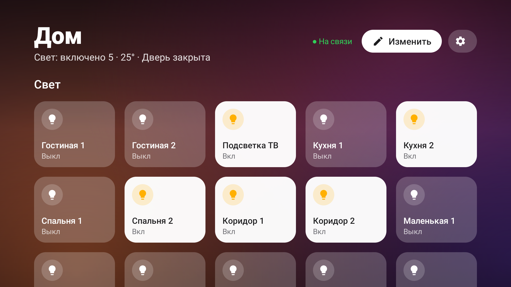
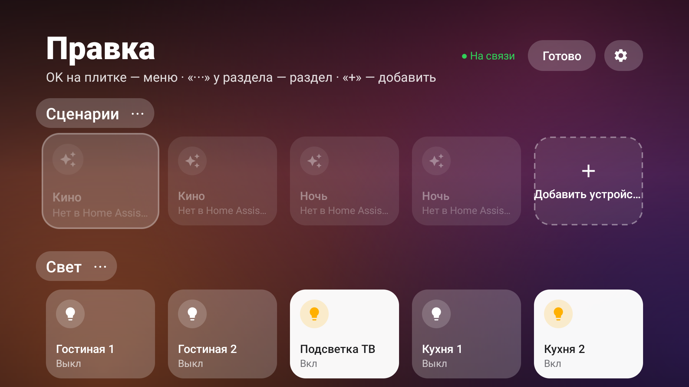

# Дом — Home Assistant на Android TV

Панель управления умным домом для телевизора, в стиле HomeKit и целиком с пульта: свет, климат, шторы, замок и
камера, пылесос и техника, датчики протечки. Состояния обновляются вживую, раскладка настраивается прямо на ТВ.

<p align="center"></p>
<p align="center"></p>

## Возможности

- **Плитки в стиле HomeKit:** стеклянные полупрозрачные плитки со значком, включённые — белые, тревога — красная;
  сводка в шапке («Свет: включено 3 · 25° · Дверь закрыта»); 7 фонов.
- **Управление:** OK переключает свет и выключатели, запускает сцены и скрипты; шторы, пылесос и кондиционер
  открывают меню; камера — на весь экран; **открытие замка — только с подтверждением, фокус на «Отмена»**.
- **Настройка с пульта:** «Изменить» → переместить плитку стрелками (в том числе в другой раздел),
  переименовать, сменить значок, скрыть, удалить; разделы — создать, переименовать, переставить, удалить;
  «+ Добавить» — устройства прямо из Home Assistant: комната → галочки. Новые устройства из HA появляются там сразу.
- **Лёгкое:** ~60 КБ, без библиотек, без фоновых служб; с Home Assistant соединяется только пока панель на экране
  (один WebSocket, подписка на нужные сущности). Android 8+ (minSdk 26), проверено на TCL P725 (Android TV 11).

## Установка

1. В Home Assistant создайте пользователя для ТВ (лучше без прав администратора) и в его профиле — **токен
   долговременного доступа**.
2. Скопируйте `config.example.json` в `config.json`, впишите адрес HA и токен. Разделы можно не править:
   раскладку удобнее собрать на ТВ через «+ Добавить». `config.json` в репозиторий не попадает (`.gitignore`).
3. На ТВ включите «Отладку по USB» (Настройки → Об устройстве → 7 раз «Сборка» → «Для разработчиков»).
4. Поставьте APK из Releases и передайте настройки:

```powershell
.\install.ps1 -TvHost <ip телевизора> -Config config.json -Apk tv-smart-home-1.0.apk
```

Без `-Apk` скрипт соберёт приложение сам (JDK 17 и Android SDK 34). Сменить адрес или токен:
`.\install.ps1 -TvHost <ip> -Config config.json -ConfigOnly`. После установки выключите на ТВ отладку.

Приложение появится в лаунчере как «Дом». В лаунчере [tv-launcher](https://github.com/fabutnm/tv-launcher) его можно
поставить в док через меню плитки (удержание OK).

## Безопасность

- Токен хранится в закрытой папке приложения; записать конфиг может только adb shell (провайдер защищён
  `WRITE_SECURE_SETTINGS`), прочитать его через провайдер нельзя.
- Home Assistant не умеет ограничивать пользователя отдельными устройствами: токен даёт управление всем домом.
  Поэтому открытие замка всегда спрашивает подтверждение.
- Только сеть к вашему HA: никакой телеметрии, рекламы и проверок обновлений.

## Конфиг и раскладка

Раскладка, собранная на ТВ, хранится на ТВ (`layout.json`) и не затирается при передаче нового конфига;
«⚙ → Сбросить раскладку» возвращает разделы из `config.json`. Ключи элемента:

| Ключ | Значение |
|---|---|
| `entity` | id сущности. С действием: light, switch, fan, input_boolean, scene, script, button, cover, vacuum, climate, lock, camera. Остальное — только показ. |
| `name` | Название (две строки, `\n` — свой перенос). |
| `icon` | bulb, power, fan, snow, curtains, lock, door, camera, vacuum, washer, dishwasher, drop, thermo, cloud, sparkle, tv, gauge, home. По умолчанию — по типу. |
| `detail` | Вторая сущность, значение через точку: `Замок · 42%`. |
| `detail_unless` | Состояния, при которых `detail` не показывается. |
| `states` | Перевод сырых состояний: `{ "Off": "Выключена" }`. |
| `any_of`, `ok`, `alarm`, `labels` | Групповая плитка: тревога, если любой из датчиков включён. |
| `confirm` | Спрашивать перед переключением. |
| `hidden` | Есть на панели, но видна только в режиме правки. |

Корень конфига: `url`, `token`, `title`, `columns` (4–6), `background` (sunset, ocean, forest, aurora, dusk,
graphite, black), `sections`.

## Сборка

```powershell
.\gradlew.bat --no-daemon testReleaseUnitTest lintRelease assembleRelease
```

Релизная подпись берётся из `~/.gradle/gradle.properties` (`RELEASE_STORE_FILE`, `RELEASE_STORE_PASSWORD`,
`RELEASE_KEY_ALIAS`, `RELEASE_KEY_PASSWORD`); без них — отладочный ключ. Новую версию: поднять `versionCode` и
`versionName` в `app/build.gradle`, собрать, создать релиз с APK. Обновление ставится поверх (`install.ps1 -Apk`),
раскладка и настройки сохраняются, если подпись та же.

## Лицензия

MIT. Значки Material Icons — Google, Apache 2.0.
